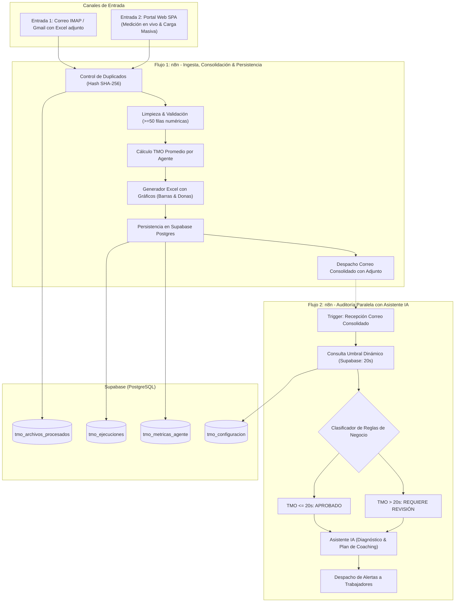

# 🎧 TMO Control Enterprise Suite - BPO Operations & AI Copilot

[](https://nodejs.org/)
[](https://tailwindcss.com/)
[](https://www.chartjs.org/)
[](https://n8n.io/)
[](https://supabase.com/)

Solución empresarial integral para la recepción, medición en tiempo real, consolidación matemática, validación con Inteligencia Artificial (NLU) y auditoría automatizada del **Tiempo Medio Operativo (TMO)** en operaciones de Contact Center / BPO.

Integra una **Single Page Application (SPA)** moderna con vistas aisladas, un motor de **Copilot IA en lenguaje natural**, un sistema de **alertas por correo a trabajadores con bajo desempeño** y flujos paralelos en **n8n** conectados a **PostgreSQL (Supabase)**.

---

## 📑 Tabla de Contenidos

- [Características Principales](#-características-principales)
- [Arquitectura del Sistema](#-arquitectura-del-sistema)
- [Estructura del Proyecto](#-estructura-del-proyecto)
- [Vistas de la Aplicación (SPA)](#-vistas-de-la-aplicación-spa)
- [Copilot de IA con NLU](#-copilot-de-ia-con-nlu)
- [Módulo de Alertas a Trabajadores](#-módulo-de-alertas-a-trabajadores)
- [Lógica de Cálculo y Reportes Excel](#-lógica-de-cálculo-y-reportes-excel)
- [Base de Datos (Supabase / PostgreSQL)](#-base-de-datos-supabase--postgresql)
- [Instalación y Puesta en Marcha](#-instalación-y-puesta-en-marcha)
- [Flujos en n8n](#-flujos-en-n8n)
- [Licencia](#-licencia)

---

## 🚀 Características Principales

* **Arquitectura SPA de Vistas Aisladas**: Navegación modular fluida (Dashboard, Cronómetro, Operadores, Copilot IA, Historial y Automatización). Al hacer scroll, solo se visualiza el contenido de la sección activa.
* **Diseño UI/UX 2.0**: Modo Oscuro OLED (`#0B0F19`) y Modo Claro empresarial, efectos de *glassmorphism*, avatares dinámicos y micro-barras de progreso.
* **Cockpit de Medición en Vivo**: Temporizador con ecualizador de audio reactivo y sintetizador sonoro nativo con Web Audio API (fases Talk Time, Hold Time y Wrap-up).
* **Copilot de IA con Comprensión de Lenguaje Natural (NLU)**: Entiende consultas en español cotidiano, responde con datos reales calculados de la memoria y ofrece planes de coaching específicos.
* **Módulo de Notificación y Alertas de Desempeño**: Envío automático de reportes individuales y planes de mejora por correo a asesores con desvíos sobre la meta ($TMO > 20\text{s}$), con el archivo Excel consolidado adjunto.
* **Reportes Excel Profesionales**: Generación automatizada con `ExcelJS` incluyendo gráficos nativos de barras y donas con formateo corporativo.
* **Automatización Dual con n8n**: Flujo 1 para ingesta y persistencia; Flujo 2 paralelo para auditoría independiente e integración LLM.

---

## 🏗️ Arquitectura del Sistema



---

## 📁 Estructura del Proyecto

```text
├── web/
│   ├── index.html                  # Portal SPA con navegación modular por vistas
│   ├── app.js                      # Lógica interactiva, NLU de IA, Chart.js y Webhooks
│   └── styles.css                  # Design System 2.0 (Variables CSS, Dark Mode, Toasts)
├── server.js                       # Servidor HTTP Node.js, Webhooks y API de Alertas
├── send_worker_alert_script.js     # Script autónomo para despacho de alertas a trabajadores
├── tmo_excel_generator.js          # Motor generador del Excel consolidado con gráficos
├── generate_validation_excel.js    # Constructor del Excel de validación y diagnóstico IA
├── simulate_complete_pipeline.js   # Simulación integral del pipeline n8n de principio a fin
├── sample_data_generator.js        # Generador de dataset de prueba con 85 registros reales
├── gestiones_call_center_50plus.xlsx # Dataset de prueba con 85 filas estructuradas
├── workflow_1_calculo_tmo.json     # Flujo n8n exportado: Ingesta, cálculo y persistencia
├── workflow_2_validacion_ia.json   # Flujo n8n exportado: Validación con IA y notificaciones
├── supabase_schema.sql             # Script SQL DDL (Tablas, RLS e índices para Supabase)
├── smtp_config.json                # Configuración de credenciales de envío SMTP
└── package.json                    # Dependencias y scripts del proyecto
```

---

## 🖥️ Vistas de la Aplicación (SPA)

La interfaz se divide en 6 vistas independientes:

| Vista | Ruta / ID | Descripción |
| :--- | :--- | :--- |
| **Dashboard General** | `#view-dashboard` | Tarjetas KPI (TMO, Talk, Hold, Wrap, Operaciones), gráficos con gradientes (barras y donas) y comparativa por canal. |
| **Cronómetro en Vivo** | `#view-livecall` | Cockpit digital para medir llamadas en tiempo real con selector de fases, ecualizador animado y registro de gestiones. |
| **Operadores & Células** | `#view-operators` | Ranking de asesores por célula (F1, F2, F3), micro-barras de progreso, estados de cumplimiento y botones de alerta. |
| **Auditoría con IA** | `#view-ai` | Chat conversacional interactivo con NLU, diagnóstico de anomalías operativas y plan táctico de coaching. |
| **Historial de Gestiones** | `#view-history` | Tabla detallada con buscador en tiempo real, filtros por agente/canal y botones de descarga de reportes. |
| **Alertas & n8n** | `#view-automation` | Módulo de drag & drop para Excel, ejecución de webhooks n8n y despacho de alertas individuales por correo. |

---

## 🤖 Copilot de IA con NLU

El centro de inteligencia cuenta con un motor de procesamiento de lenguaje natural (NLU) adaptado al dominio BPO:
- **Consultas sobre agentes específicos**: *"¿Cómo le fue a Andrés hoy?"*, *"¿Qué problemas tiene Felipe?"*, *"¿Quién tuvo el mejor TMO?"*.
- **Consultas sobre canales**: *"¿Por qué Soporte Técnico demora tanto?"*, *"¿Cómo va WhatsApp?"*.
- **Generación de planes de acción**: *"¿Qué plan sugieres para la próxima semana?"*.
- **Botones de acción directa dentro del chat**: Permite despachar la notificación al trabajador directamente desde la respuesta del modelo.
- **Guardrails**: Rechaza preguntas fuera de contexto orientando al usuario hacia las métricas de la campaña.

---

## 📧 Módulo de Alertas a Trabajadores

Diseñado para retroalimentar a los trabajadores con bajo desempeño ($TMO > 20\text{s}$):
1. **Detección Automática**: Identifica a los agentes con desviaciones críticas (ej. Andrés Morales con 25.45s, +27.3% sobre la meta).
2. **Generación de Reporte Constructivo**: Redacta un correo profesional con el desglose de Talk, Hold y Wrap-up, destacando el plan de coaching.
3. **Despacho Inmediato**: Envía el correo vía SMTP seguro adjuntando el archivo Excel consolidado oficial.

---

## 🧮 Lógica de Cálculo y Reportes Excel

### Fórmula Oficial de TMO
Para cada agente único sin duplicados:

$$\text{TMO Promedio} = \frac{\sum \text{Tiempos de Gestión}}{\text{Cantidad de Gestiones Válidas}}$$

$$\text{Porcentaje de Desviación} = \left( \frac{\text{TMO Promedio} - \text{Límite Meta}}{\text{Límite Meta}} \right) \times 100$$

### Especificación del Libro Excel (`reporte_consolidado_tmo.xlsx`)
1. **Hoja "Consolidado TMO"**: Tabla de resumen por asesor, tiempos acumulados, badges condicionales (verde para Aprobado $\le 20\text{s}$, rojo para Requiere Revisión $> 20\text{s}$) y fila de totales.
2. **Hoja "Dashboard & Gráficos"**: Tarjetas de KPI y dos gráficos embebidos (Barras con colores según umbral y Donas con porcentaje de cumplimiento).
3. **Hoja "Datos Originales"**: Detalle fila por fila de las 85+ gestiones registradas.
4. **Hoja "Validación IA"**: Diagnóstico narrativo y plan de mejora.

---

## 🗄️ Base de Datos (Supabase / PostgreSQL)

Para inicializar la persistencia en Supabase:
1. Ve al **SQL Editor** en tu panel de Supabase.
2. Ejecuta el archivo [`supabase_schema.sql`](supabase_schema.sql).
3. Tablas creadas:
   * `tmo_configuracion`: Para ajustar el umbral meta sin reiniciar servicios:
     ```sql
     UPDATE public.tmo_configuracion SET valor_numerico = 20.00 WHERE clave = 'tmo_limite_segundos';
     ```
   * `tmo_archivos_procesados`: Hashes SHA-256 para evitar duplicar archivos ya auditados.
   * `tmo_ejecuciones`: Registro histórico de corridas, métricas globales y respuestas de IA.
   * `tmo_metricas_agente`: Trazabilidad temporal individual por asesor.

---

## ⚡ Instalación y Puesta en Marcha

### Prerrequisitos
* [Node.js](https://nodejs.org/) v18 o superior.
* Servidor SMTP (Gmail, Outlook o corporativo).

### 1. Clonar e Instalar Dependencias
```bash
git clone https://github.com/tu-usuario/tmo-control-enterprise.git
cd tmo-control-enterprise
npm install
```

### 2. Iniciar el Servidor de la Aplicación
```bash
node server.js
```
Abre en tu navegador: **[http://localhost:3333](http://localhost:3333)**

### 3. Ejecutar Pipeline de Simulación Completo (Consola)
```bash
node simulate_complete_pipeline.js
```

### 4. Probar Envío de Alerta Individual a Trabajador
```bash
node send_worker_alert_script.js
```

---

## 🔄 Flujos en n8n

1. En tu instancia de n8n, ve a **Workflows** -> **Import from File**.
2. Importa los dos archivos:
   * [`workflow_1_calculo_tmo.json`](workflow_1_calculo_tmo.json) (Flujo 1: Ingesta, consolidación y persistencia).
   * [`workflow_2_validacion_ia.json`](workflow_2_validacion_ia.json) (Flujo 2: Validación con IA y alertas).
3. Configura las credenciales de **Supabase Postgres**, **SMTP / IMAP** y **OpenAI / Claude**.
4. Activa ambos flujos (**Active: ON**).

---

## 📄 Licencia

Este proyecto está bajo la Licencia [ISC](LICENSE). Desarrollado para optimización y auditoría de tiempos operativos en centros de contacto.
